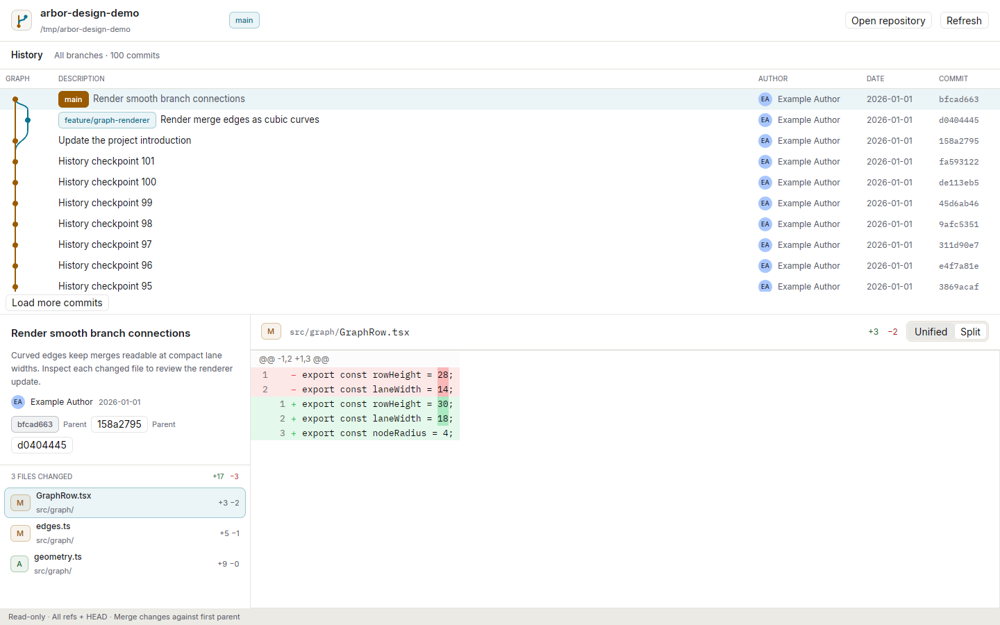
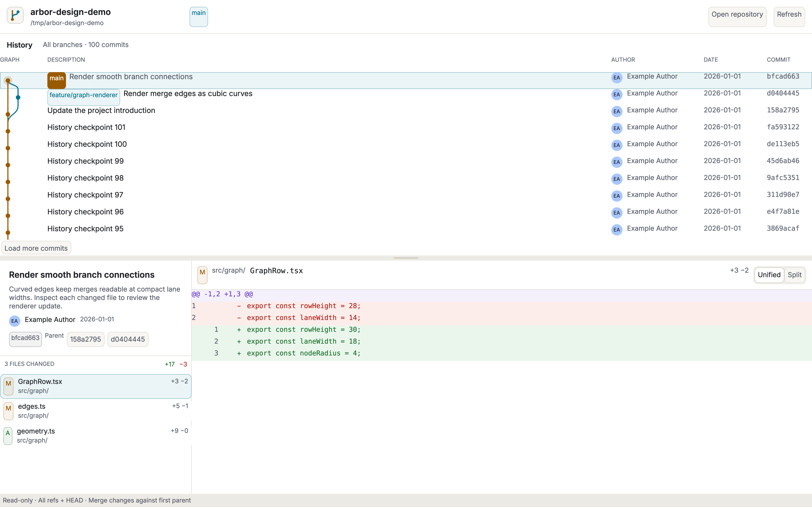
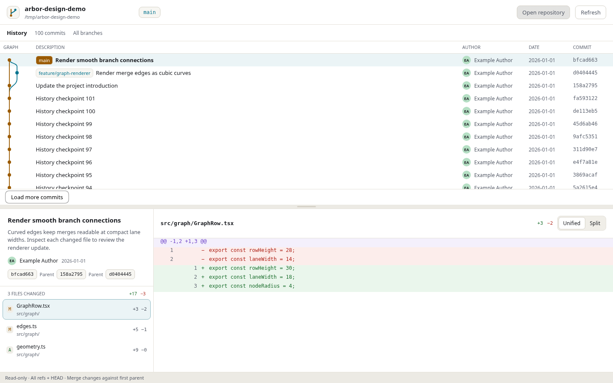

# Three native Git workspaces

This is the comparison record for GPUI Kit, Rune and Expo Exact. Findings cover implementation and tests actually performed. Native macOS CI observations are recorded below; manual Mac interaction and performance comparisons still need a Mac.

## Common functionality and design

The visual reference is the user's [Arbor design artifact](https://claude.ai/artifact/VpSMpWpzvcTJDMwJZbX6pr#play-15dd8cd198dd), applied in **light** mode as requested. Its public HTML and canvas source were inspected and rendered locally before adapting the clients. The layout retains the earlier [Fork](https://fork.dev/) requirement: branch graph above, changed files left and diff right below. Arbor supplies the warm canvas (`#ECEAE4`), white panels, stone borders (`#E4E1D9`), teal selections (`#06748F`), amber/teal/purple/green graph lanes and soft diff fills. Commit metadata now sits inside the files sidebar. Compact author avatars, separate ref chips, a branch logo and Unified/Split controls follow the reference. Unsupported write operations from the reference are omitted; Open and Refresh remain real controls. Typography uses bundled Inter/IBM Plex Mono in the Rust apps and the host fonts in Exact.

All three apps provide:

- A native repository folder chooser and refresh.
- A top pane with actual ancestry lanes, commit nodes, branch/tag/HEAD labels, subjects, authors, IDs and dates.
- History from **all refs plus HEAD**, in topological order, including unmerged branches. History loads in pages of 100.
- Commit metadata and full messages in a bounded, scrollable area.
- A lower-left changed-files list with addition, modification, deletion and rename status, real per-file and commit addition/deletion counts, basenames and directories.
- A lower-right diff scoped to the selected file, initially the first changed file, with functional unified and side-by-side views and old/new line numbers. Selecting a different commit resets the file selection.
- Root-commit additions, binary summaries, rename paths and first-parent merge changes. Empty commits have a distinct no-file-changes state.

This remains a read-only browser. Branch labels describe refs; they do not check out or edit branches. No fetch, pull, staging, commit creation or repository mutations are included.

The Rust frontends share `crates/git-core`; Exact implements the same Git argument arrays in `git.ts`. NUL-delimited records protect paths containing spaces, tabs and newlines. Literal pathspec mode prevents filenames such as `:(glob)*` being interpreted as patterns. External diff and textconv programs are disabled. Very large diff displays are truncated visibly at 2 MB, after collecting Git's output; this is not a bounded-memory streaming implementation.

## Framework sources inspected

| Framework | Pinned version | Examples and reference material |
| --- | --- | --- |
| GPUI Kit | `gpui-kit = 0.9.1`, matching `gpui-pre-* = 0.3.12` | Longbridge GPUI Kit README, design/coding guides, `examples/hello_world`, `examples/tig`, Diff and resizable-panel source. Inspected checkout `6808964c3a5e0ef970e47b696e8a800575cb21a7`; application consumes the published release. |
| Rune | anomalyco/rune `2a44156b21d63b0342a366b26d9222a6edd4622c` | `examples/hello`, core README, shape, virtual-row, file-dialog, AppSpec and Waker source. |
| Exact | expo/exact `d5a51c9bb37efeecdd81fa0539adc2fe611d91b6` | `docs/start-here.md`, generated `list-detail` pattern, child-process fixture, responsive-column and Tamber recipes. |

The first GPUI implementation used published GPUI 0.2.2. This revision adopts Kit's matching GPUI family rather than mixing incompatible GPUI types between releases.

## GPUI Kit

**Easy:** Kit's Tig example is close to this domain and demonstrated the right initialization, root window, diff state and panel composition. Buttons supply real control behavior; resizable panels provide both the horizontal history/changes split and the vertical files/diff split. The built-in Diff component supplies hunk headers, old/new line numbers, colored changes, text selection, horizontal scrolling and binary notices. Its parser accepts the selected file's real Git patch.

**Difficult:** Kit requires its exact GPUI snapshot, so adopting it was a dependency migration, not an extra widget import. Theme initialization, the root wrapper, registered fonts and component state all matter. A layout builder extension (`StyledExt`) must be in scope, and the newer window-close callback has a different signature. Linux needed Fontconfig pkg-config metadata and development linker names for xcb, freetype and xkbcommon; these are Linux preparation steps, not Mac requirements.

**Result:** the most complete reusable desktop primitives of the three for this screen. Kit owns selection and line-number behavior in the diff, while the application still owns graph layout and Git data. Inter and IBM Plex Mono are bundled with their licenses. The application forces the requested light theme.

## Rune

**Easy:** plain Rust state, view functions and typed folder-dialog callbacks remained direct. The worker can wake the runtime without an idle timer. Shape drawing is enough for the branch graph; built-in virtual rows handle commit and diff lists. Headless runtime tests can answer the real dialog callback and click rows without a GPU.

**Difficult:** every scroll viewport needs bounded ancestors and `min_h(0)`. Virtualization also needs a growth stack. A virtual row's source key becomes its runtime identity, which matters when driving tests. A custom diff surface requires application work: decoding hunk coordinates, distinguishing notices and pairing insertion/deletion blocks for split view are implemented in the shared Rust module. This does not reproduce Kit's text selection or advanced diff interactions. The mono font family must be configured explicitly rather than leaving the default sans family behind a mono token.

**Result:** relatively little infrastructure for a custom, compact light workspace. The layout, graph and patch rendering remain owned by the app. Commit and file selection are validated through Rune's actual UI callbacks. Pane proportions are fixed; GPUI Kit alone currently supplies drag-resizing as a presentation convenience.

## Exact

**Easy:** generated shape declarations make the data seam explicit. Resources drive loading/error states. The desktop child-process package runs Git without a custom native bridge. Tamber provides a single light palette with explicitly fixed-scheme tokens, and rem-based table typography/widths preserve text scaling. The same Contract defines the workspace on native and web hosts.

**Difficult:** Contract's shape/option syntax and vocabulary need learning. `max-content` is not supported as `min-width`; an explicit scrollable minimum works. The initial literal colors and fixed pixel fonts triggered useful verifier findings. The fixed light design is intentional, as requested, so it is declared in Tamber rather than pretending to offer dark mode. A patch's lines need stable IDs at the data seam instead of using loop positions as record keys. Native programs are not available in the web host, and Exact's native agent requires scripted process mappings. A cold full-SDK setup also installs web/mobile toolchains and prepares game documentation even for this Mac app, increasing CI setup time and the number of dependencies that can fail. CI now restores SDK/app build outputs, Cargo dependencies, Hermes bundles, Chromium and other runtime downloads. The first cache-populating run remains cold; later builds can reuse it, but warm timings have not been measured. Build profiles also differ: the GPUI/Rune previews use Cargo dev with debug symbols disabled, while Exact’s `host-dev` inherits release optimization, with whole-graph LTO disabled and incremental compilation enabled, and builds a substantial Swift presenter. Cold build duration is therefore not a controlled framework-performance comparison. The SDK’s native test driver also builds missing/stale hosts first and hides build output in `.exact/macos-build.log` unless it fails. CI now builds the bundle explicitly before the screen test so build time and compiler progress are visible separately.

**Result:** a light top/bottom workspace with ancestry SVG rows, changed files and colored per-file diffs. The Mac folder chooser uses a fixed osascript program; Git always receives argument arrays. Additional pages currently re-read the loaded prefix instead of appending a skip-based page. It has fixed pane proportions. Its custom unified/split diff renderer required a second implementation of hunk coordinates and change pairing; it offers fewer text interactions than Kit. Styling buttons explicitly avoids the browser host’s default control chrome in the visual check.

## Validation evidence

- Both Rust applications compile and link on Linux and on the Apple Silicon macOS GitHub runner.
- Six Rust core tests pass: two cover hunk line numbers, split pairing and binary notices; four use real repositories for empty/invalid paths, roots, Unicode, paging, merges, Git directories, unmerged branch refs, rename records, and isolated literal-path diffs.
- Rune's UI interaction test passes: open/cancel the folder chooser, choose a real repository, select a commit, then switch between two changed files and check that the patch is replaced. It also switches Unified/Split and checks the state.
- Five TypeScript Git tests pass with 30 assertions, covering real repositories plus hunk coordinates and split pairing.
- GPUI Kit was launched under Xvfb with Mesa's software Vulkan driver. The graph and changes workspace was inspected, selecting the binary file changed the diff to Kit's binary summary, and dragging both dividers changed the pane sizes. Prior pagination checks expanded the same fixture from 100 to 105 commits. After the Arbor redesign, live clicking switched between unified/split rendering and changed files; the displayed path and patch changed together.
- Exact's production Contract compiles without warnings. Its initial-screen test passes and `verify` is clean, including both configured widths, both system appearances, reload and large text. The intentionally light palette is retained in either system appearance. These checks run separately from the populated workspace test.
- `tools/exact-ui-smoke.ts` captures replies from real Git into a **test-only** data seam, then drives the unchanged production Contract in Chromium. It checks the three panes, switches files and commits, verifies the actual patch reply, switches Unified/Split and loads the remaining history. This tests the populated UI; it does **not** claim that the web runs native processes or that native Mac integration was exercised.
- On 11 November 2026, the native Rust builds, six core tests and Rune interaction test passed on GitHub’s macOS 26.7.2 Apple Silicon runner. The ad-hoc signed GPUI and Rune bundles each remained running for ten seconds with a real repository. This establishes compilation, tests and process startup; no native Mac visual interaction, startup timings or memory measurements are claimed. Lean semantics are not installed; Exact's exploratory property walks are observations rather than proofs.

## Screens inspected

These are Linux captures. Exact's populated image uses the real-Git snapshot seam described above. The fixture comes from `python3 tools/make-fixture.py <empty-directory>`; the current visual fixture contains 105 commits, a merge, source changes and branch labels. Earlier binary/Unicode checks used a separate real repository; the parser and Git tests retain edge-case coverage.

## Downloadable Mac previews

The [macOS workflow](https://github.com/mountainforge/rune-chat/actions/workflows/macos.yml) produces ad-hoc signed development `.app` bundles in DMGs with an Applications shortcut, plus ZIP copies. Successful previews are published to [GitHub Releases](https://github.com/mountainforge/rune-chat/releases), with checksums. Current runner output targets Apple Silicon, not Intel. The builds are not Developer ID signed or notarized. Replaced runs on the same branch are cancelled automatically. GPUI, Rune and Exact build independently; release publication checks for successful app artifacts even when other jobs fail.

The first Exact setup attempt exposed an outer Cargo-workspace discovery error in its vendored Hermes installer. Excluding `.deps/exact` from this repository's Rust workspace resolves that error; the standalone installer workspace was checked locally before retrying. The retry passed this stage but Exact setup ultimately failed because it installed Playwright Chromium revision 1248 and then checked for revision 1254. The repository setup now installs the SDK’s frozen Bun dependencies **before** importing its CLI: previously the CLI could resolve auto-installed tooling before its own setup replaced that tooling with the lockfile version. A fresh local process confirms that the SDK and its locked Playwright now resolve the same Chromium executable. No Exact Mac app is released yet. GPUI and Rune DMGs were published independently in [preview 3](https://github.com/mountainforge/rune-chat/releases/tag/macos-preview-3-1).

## Mac evaluation still needed

Run the same repository in each app. Check native chooser cancellation, an invalid directory, an empty repository, a linked worktree, a bare repository, unmerged branches and tags, more than 100 commits, roots, merges, renames/deletions/binaries and a large diff. Switch files repeatedly and confirm the selected path and patch agree; check both Unified and Split views and compare addition/deletion totals with Git. Resize the window; in GPUI also drag both dividers. Inspect long messages, keyboard/focus behavior, dark system appearance with the intentionally light application, and large text.

Measure cold/warm startup and memory on the same Mac before ranking performance. Source execution is provided; signed and notarized distributable bundles remain outside this task.

## Current assessment

GPUI Kit now offers the strongest reusable desktop controls and diff engine for this workspace. Rune keeps custom Rust rendering and state management direct, with useful headless hooks, but more desktop interaction must be implemented by the app. Exact offers typed declarative composition and strong diagnostics, at the cost of another language and a separate native-runtime toolchain. These are implementation findings, not a performance ranking. Append actual Mac results here when available.
